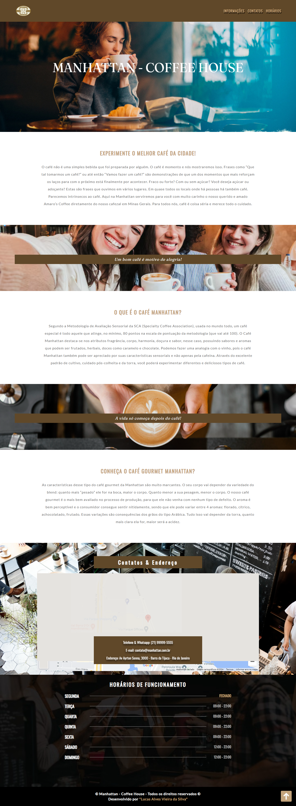

# Manhattan — Coffee House

Site de apresentação de uma cafeteria, desenvolvido com HTML, CSS e JavaScript. Reúne informações sobre cafés, contatos, localização e horários.



## Recursos

- Navegação entre as seções de informações, contatos e horários.
- Menu alternável por JavaScript.
- Botão de retorno ao topo com rolagem suave.
- Mapa incorporado pelo Google Maps.
- Imagens de fundo e fontes carregadas pelo Google Fonts.

## Como visualizar

```bash
git clone https://github.com/alvesvslucas/cafeteria.git
cd cafeteria
```

Abra `index.html` em um navegador. O mapa e as fontes externas dependem de internet.

## Estrutura

- `index.html`: conteúdo da página.
- `css/style.css`: estilos.
- `js/main.js`: menu e retorno ao topo.
- `img/`: imagens, logotipo e captura de demonstração.
- `LEIA-ME.md`: versão anterior da apresentação do projeto.

## Créditos

O rodapé identifica Lucas Alves Vieira da Silva como desenvolvedor e preserva o aviso de direitos da Manhattan — Coffee House.

